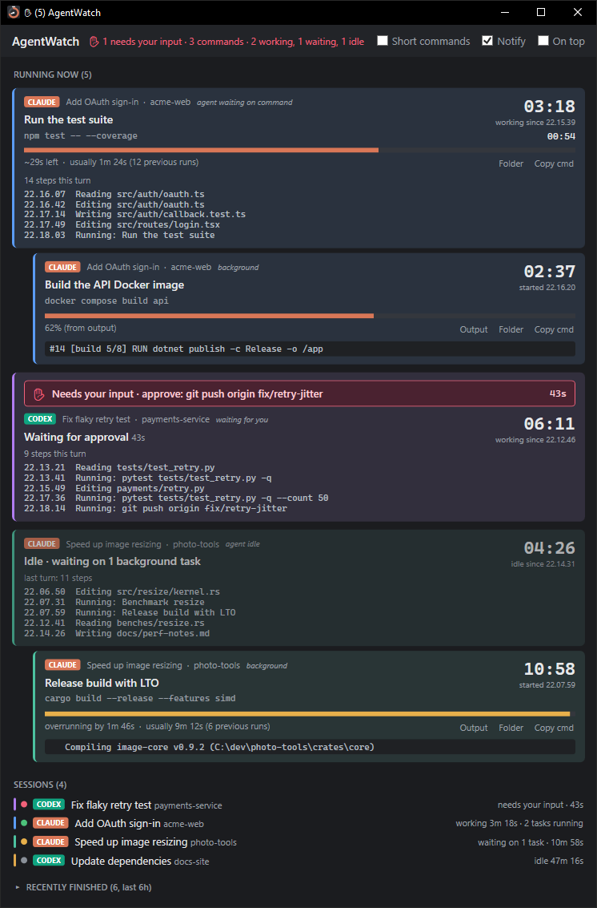

# AgentWatch

A small Windows app (WPF, .NET 10) that shows what **Claude Code** and **OpenAI Codex** are running right now:
every shell command and subagent, foreground or background, with a live timer, an estimated progress bar,
and the latest output line.



## Requirements

- Windows 10 or 11
- [.NET 10 SDK](https://dotnet.microsoft.com/download/dotnet/10.0)
- Claude Code and/or OpenAI Codex, used on the same machine

## Build and run

```
git clone https://github.com/Tieho/AgentWatch.git
cd AgentWatch
dotnet build -c Release
src\AgentWatch\bin\Release\net10.0-windows\AgentWatch.exe
```

**Running now** groups everything by session, and each session has its own accent color (stripe and faint tint).
A working session gets an activity card showing what the agent is doing right now (thinking, writing,
reading or editing a file, running a command, using a subagent or MCP tool), how long it has been working,
and its last few steps. Below that card are the session's running commands with timers and progress.
A session that is idle but still has background jobs shows as **waiting** in the Sessions list.

When an agent is blocked on you (a permission prompt, a question, plan approval, a dialog, or a Codex approval
request), its card gets a red **✋ Needs your input** banner with how long it has waited, its Sessions dot turns red,
the window title and summary show ✋, and a tray notification appears.

Closing the window hides it to the tray. Use the tray icon's **Exit** to quit. Tray notifications show when
a background task, or any task longer than 15 s, finishes.

## Where the data comes from (read-only)

| Source | What is read |
|---|---|
| `~/.claude/sessions/<pid>.json` | Live Claude Code sessions (name, cwd, busy/idle) |
| `~/.claude/projects/*/<session>.jsonl` (+ `subagents/`) | Tool calls, background task IDs, `.output` files, completion notices |
| `~/.codex/state_5.sqlite` | Codex threads (name, cwd, rollout file) |
| `~/.codex/sessions/**/rollout-*.jsonl` | In-flight Codex commands while a thread is active |
| `~/.codex/thread_history_1.sqlite` | Finished Codex commands, busy turns |

## Progress estimates

- If a background task's output contains `NN%` or `[n/m]`, that is used directly ("from output").
- Otherwise the app uses the median of past durations of the same command, matched on the exact normalized
  command, then the task description, then a coarse key such as `dotnet build` or `unity -executeMethod X`.
- On first start it learns from all existing transcripts and Codex history (a few seconds). After that it records
  each command it sees finish. History is stored in `%LOCALAPPDATA%\AgentWatch\history.json`, and settings
  in `settings.json` in the same folder.

`AgentWatch.exe --dump` writes what is currently detected to `%LOCALAPPDATA%\AgentWatch\dump.txt`
(for debugging).

## Privacy

AgentWatch only reads the local files listed above. It never writes to them, and it makes no network
connections. Everything it stores stays in `%LOCALAPPDATA%\AgentWatch`.

## License

[MIT](LICENSE)
